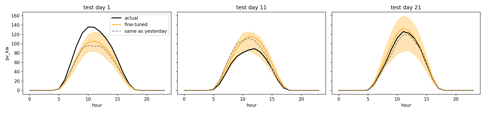

# Applied ML C: Fine-tuning Chronos on solar data

CS197 MLC cohort · Mariam Yusuff, Adam Lawal, Tunde Egunjobi, Ayodeji Akande, Chima Precious Ikwen

We wanted to see whether a pretrained time-series model gets better at forecasting solar power after we fine-tune it on solar data. Grid operators plan tomorrow's supply around forecasts like this, so even small gains matter.

We used [Chronos](https://arxiv.org/abs/2403.07815) (`amazon/chronos-t5-mini`). It treats a time series like a sentence: it scales the values, puts each one into a bin, and each bin becomes a token that a normal T5 language model learns to predict.


## What we did

- **Data:** hourly solar output (`pv_kw`) from a [microgrid dataset on Hugging Face](https://huggingface.co/datasets/Tristanchou/Preference-Conditioned-Heterogeneous-MARL-Microgrid), from 2016 onwards. The dataset card says this column is rescaled from real OPSD data, so it isn't raw readings from one plant.
- **Split by time:** everything up to the last 60 days for training, then 30 days for validation and 30 days for test.
- **Windows:** 168 hours of history in, the next 24 hours out.
- **Training:** Hugging Face `Trainer` (the same approach as Lecture 4), 1 epoch, trying learning rates 1e-5, 1e-4 and 1e-3, and picking the best one on validation.
- **Scoring:** mean absolute error (MAE) on the test month, compared with Chronos zero-shot and with "same as yesterday".

We planned to track runs with Weights & Biases (Lectures 8 & 9), but W&B had paused new sign-ups when we tried. Instead, every run is logged to `outputs/tuning_log.csv`.

## Results

Mean absolute error on the 30 held-out test days (September 2020). Lower is better.

| | test MAE (kW) | vs same-as-yesterday |
|---|---|---|
| Same as yesterday | 6.251 | n/a |
| Chronos zero-shot | 5.861 | 6.2% better |
| Chronos fine-tuned (lr 1e-3, 1 epoch) | 5.806 | 7.1% better |



**What we found:** Chronos beats "same as yesterday" without any training on our data, so pretraining does most of the work. Fine-tuning for one epoch gave no clear extra gain. It was 0.9% better than zero-shot on the test month, but on the validation month all three learning rates were slightly *worse* than zero-shot (5.79–5.91 kW vs 5.65 kW). The largest learning rate (1e-3) did best, which suggests longer training might help. Every run is logged in `notebooks/outputs/tuning_log.csv`.

## Running it

```bash
pip install chronos-forecasting pandas matplotlib jupyter
cd notebooks && jupyter lab chronos_solar_finetune.ipynb
```

It runs on a Mac (Apple GPU), on Kaggle, or on CPU (slowly). The dataset downloads into `data/` the first time you run it.

## Repo

- `notebooks/chronos_solar_finetune.ipynb`: the main notebook
- `notebooks/team-drafts/`: our earlier attempts
- `GPT-2_fine_tune/`: the Lecture 4 exercise we did before this project

## Who did what

- **Mariam Yusuff:** built the main pipeline the final notebook is based on: data loading and checks, the time split, sliding windows, tokenization, evaluation against the naive baseline, and the grid search with the CSV log. She also tried fine-tuning with Amazon's official Chronos training script (`team-drafts/chronos-fine-tune.ipynb`).
- **Chima Precious Ikwen:** built our first end-to-end fine-tuning run with the Hugging Face `Trainer`: a custom PyTorch `Dataset` for Chronos tokens, a tokenization check, and saving the model (`team-drafts/chronos-fine-tuning-task.ipynb`).
- **Adam Lawal:** brought the drafts together into the final notebook, got it running locally, set up the repo, the system design and the slides, and proofread everything.
- **Tunde Egunjobi:** _to confirm_. Presents evaluation and tuning.
- **Ayodeji Akande:** _to confirm_. Presents the results.

See [docs/presentation-guide.md](docs/presentation-guide.md) for how we split the talk.

## What's missing / next

There are no weather inputs yet, and weather is the biggest factor in solar output. We only tested on one month with one seed, and only tuned the learning rate. The last few hours of the dataset repeat the same value (13.7 kW overnight), which looks like a fill at the end of the file. Next we'd like to try Nigerian solar data and add weather (Chronos-2 supports extra inputs).
